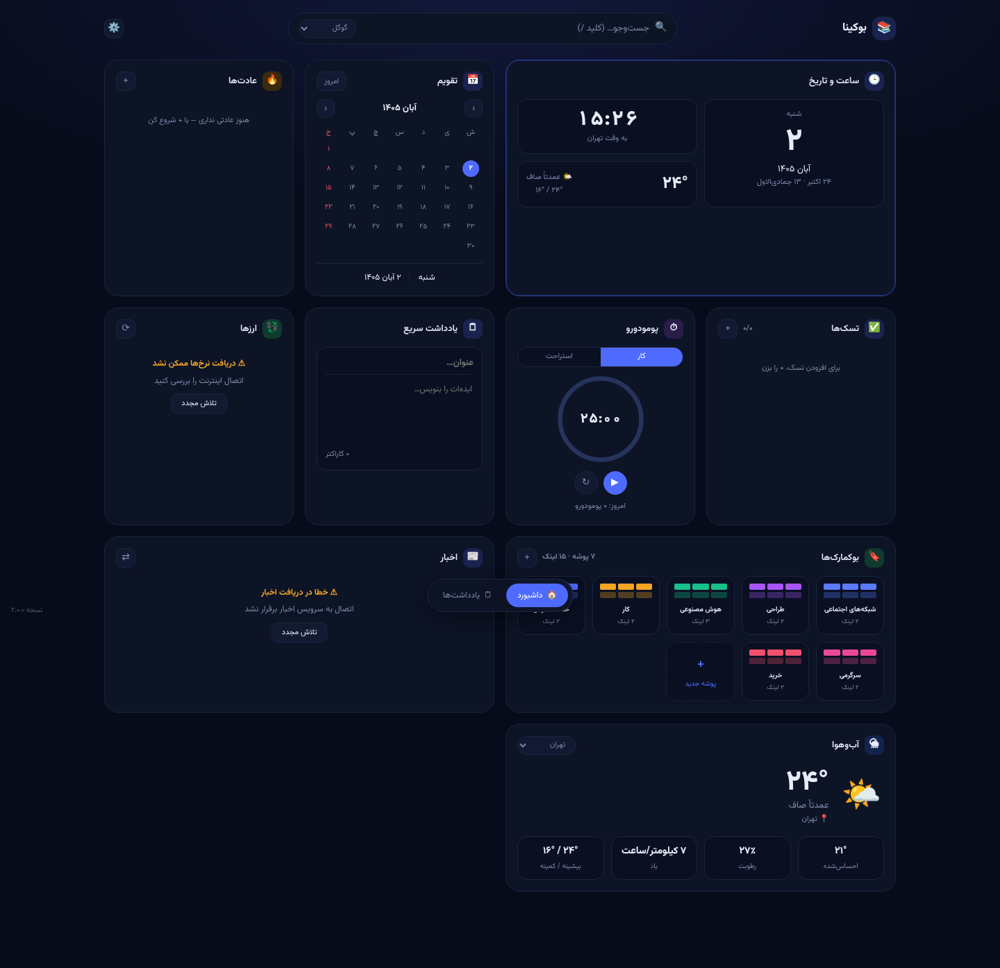
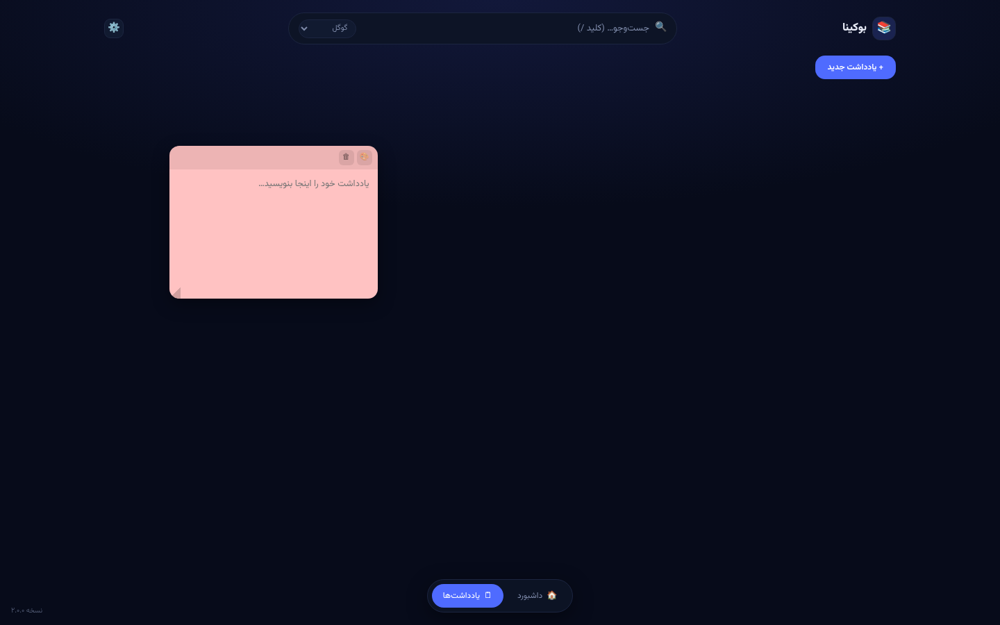
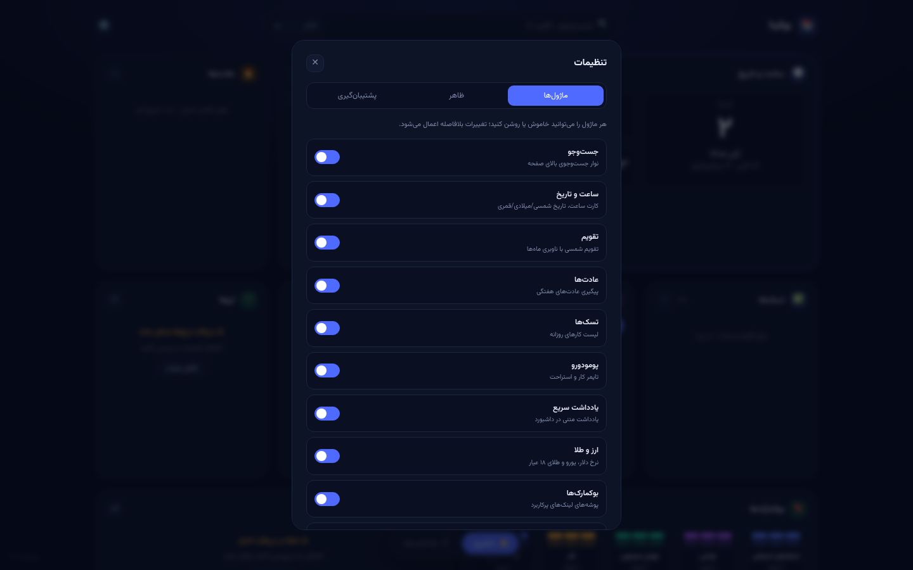

# Bookina - بوکینا

<div dir="rtl">

# بوکینا - داشبورد شخصی فارسی

بوکینا یک داشبورد شخصی مدرن و بهینه‌شده برای تب جدید مرورگر کروم است که با **سیستم دیزاین ویجت تیره**، فونت وزیرمتن و رابط کاربری کاملاً فارسی توسعه یافته است.



## ✨ ویژگی‌ها

### 🕒 ساعت و تاریخ
- نمایش هم‌زمان تاریخ شمسی، میلادی و قمری
- ساعت به وقت تهران
- ویجت سریع آب‌وهوای شهر انتخابی داخل کارت تاریخ

### 📅 تقویم شمسی
- تقویم جلالی با ناوبری ماه‌ها و دکمه «امروز»
- هایلایت روز جاری، قرمز بودن جمعه‌ها
- الگوریتم تبدیل تاریخ دقیق (تست‌شده با تست‌های رفت‌وبرگشت برای سال‌های کبیسه)

### 🔥 عادت‌ها
- پیگیری عادت‌های هفتگی با هدف هفتگی و نوار پیشرفت
- ثبت روزانه با یک کلیک، پنج رنگ دلخواه
- ریست خودکار در شروع هر هفته (شنبه)

### ✅ تسک‌ها
- افزودن سریع با کلید Enter، تیک زدن و حذف
- شمارنده انجام‌شده در هدر ویجت

### ⏱ پومودورو
- تایمر کار ۲۵ دقیقه‌ای و استراحت ۵ دقیقه‌ای
- حلقه پیشرفت SVG، تعویض خودکار حالت
- صدای اعلان و شمارنده پومودوروهای روز

### 🗒 یادداشت سریع
- یادداشت متنی با عنوان و متن، ذخیره خودکار و شمارنده کاراکتر

### 💱 ارزها
- نرخ لحظه‌ای دلار، یورو و طلای ۱۸ عیار (از فید عمومی TGJU)
- نمایش درصد تغییر روزانه و نمودار کوچک روند
- کش کردن نرخ‌ها برای نمایش آفلاین

### 🔖 بوکمارک‌ها (پوشه‌ای)
- سازمان‌دهی لینک‌ها در پوشه‌های رنگی
- افزودن، ویرایش و حذف پوشه و لینک
- چند پوشه پیش‌فرض در اولین اجرا

### 📰 اخبار
- تازه‌ترین اخبار زیومیت با تصویر شاخص و زمان نسبی («۵ دقیقه پیش»)
- دریافت مستقیم فید RSS بدون واسطه (در افزونه) با فال‌بک چندلایه روی سرویس‌های پراکسی
- کش کردن اخبار و به‌روزرسانی خودکار هر ۲ ساعت

### 🌦 آب‌وهوا
- بر بستر Open-Meteo — بدون نیاز به API Key
- ۱۱ شهر ایران، دما، احساس‌شده، رطوبت، باد و بیشینه/کمینه
- کش هوا برای نمایش سریع در باز کردن تب

### 🔍 جست‌وجو
- نوار جست‌وجو با انتخاب موتور (گوگل، بینگ، داک‌داک‌گو، ویکی‌پدیا)
- میانبر کیبورد `/` و تشخیص هوشمند آدرس سایت

### ↕️ چیدمان دلخواه کارت‌ها
- هر کارت ماژول را می‌توان با گرفتن آیکون شش‌نقطه‌ای ↕ در هدر کارت، با درگ جابه‌جا کرد
- ترتیب کارت‌ها به‌صورت خودکار ذخیره می‌شود و در بکاپ هم لحاظ می‌شود

### 📌 یادداشت‌های چسبان
- تب جداگانه با یادداشت‌های رنگی
- جابه‌جایی با درگ، تغییر اندازه و ۶ رنگ پاستلی



### ⚙️ تنظیمات (ویژگی کلیدی نسخه ۲)
- **روشن/خاموش کردن هر ۱۲ ماژول** به‌صورت جداگانه — تغییرات بلافاصله اعمال می‌شود
- انتخاب پس‌زمینه از ۸ تصویر آماده، پس‌زمینه پیش‌فرض گرادیانی یا تصویر سفارشی
- بکاپ‌گیری و بازیابی کامل داده‌ها در یک فایل JSON
- بازنشانی تنظیمات



## 🚀 نصب و راه‌اندازی

### نصب به عنوان افزونه کروم

1. فایل پروژه را دانلود کنید
2. مرورگر کروم را باز کنید و به آدرس `chrome://extensions/` بروید
3. گزینه «Developer mode» را از گوشهٔ بالا سمت راست فعال کنید
4. روی "Load unpacked" کلیک کنید و پوشه پروژه را انتخاب کنید
5. افزونه بوکینا نصب شده و در تب جدید نمایش داده می‌شود

### اجرا به عنوان برنامه وب

1. فایل `index.html` را در مرورگر باز کنید (یا با یک سرور استاتیک سرو کنید)
2. برنامه به صورت مستقیم اجرا می‌شود

## 🏗 معماری فنی

### ساختار ماژولار
```
src/
├── main.js              # نقطه ورود + رجیستری ماژول‌ها (روشن/خاموش)
├── modules/
│   ├── clock.js         # ساعت و تاریخ سه‌گانه + هوای سریع
│   ├── calendar.js      # تقویم شمسی
│   ├── habits.js        # عادت‌های هفتگی
│   ├── todos.js         # تسک‌ها
│   ├── pomodoro.js      # تایمر پومودورو
│   ├── quickNote.js     # یادداشت سریع
│   ├── rates.js         # نرخ ارز و طلا
│   ├── bookmarks.js     # بوکمارک‌های پوشه‌ای
│   ├── weather.js       # آب‌وهوا (Open-Meteo)
│   ├── news.js          # اخبار
│   ├── stickyNotes.js   # یادداشت‌های چسبان
│   ├── search.js        # جست‌وجو
│   └── settings.js      # تنظیمات + تاگل ماژول‌ها
└── utils/
    ├── storage.js       # ذخیره‌سازی (Chrome Storage / localStorage)
    ├── date.js          # تبدیل شمسی/میلادی/قمری + اعداد فارسی
    └── dom.js           # ابزارهای DOM، نوتیفیکیشن، دیالوگ تأیید
```

### تکنولوژی‌ها
- **HTML5 + CSS3** — سیستم دیزاین ویجت تیره (کارت‌های ۲۰px، پالت آبی #4f6bff)
- **JavaScript ES6 Modules** — بدون هیچ وابستگی خارجی
- **فونت وزیرمتن** به‌صورت لوکال (بدون نیاز به اینترنت)
- **Chrome Extension Manifest V3**

### API‌های استفاده شده
- Open-Meteo برای آب‌وهوا (رایگان و بدون کلید)
- TGJU برای نرخ ارز و طلا
- rss2json برای فید اخبار

## 🔧 توسعه

### افزودن ماژول جدید
1. فایل جدید در `src/modules/` بسازید و کلاس ماژول را با متد `initialize` بنویسید
2. در `src/main.js` به `MODULE_FACTORIES` اضافه کنید
3. در `src/modules/settings.js` به `MODULE_INFO` اضافه کنید تا تاگل تنظیمات هم ساخته شود

### نکات
- برای خاموش/روشن شدن خودکار، کارت ویجت باید `data-module="نام‌ماژول"` داشته باشد
- هر ماژول می‌تواند متد‌های `destroy`، `refresh` و `saveState` داشته باشد

## 📄 لایسنس
این پروژه تحت لایسنس MIT منتشر شده است.

## 📞 پشتیبانی
برای گزارش باگ یا پیشنهاد ویژگی جدید، لطفاً از بخش Issues در گیت‌هاب استفاده کنید.

---

</div>
